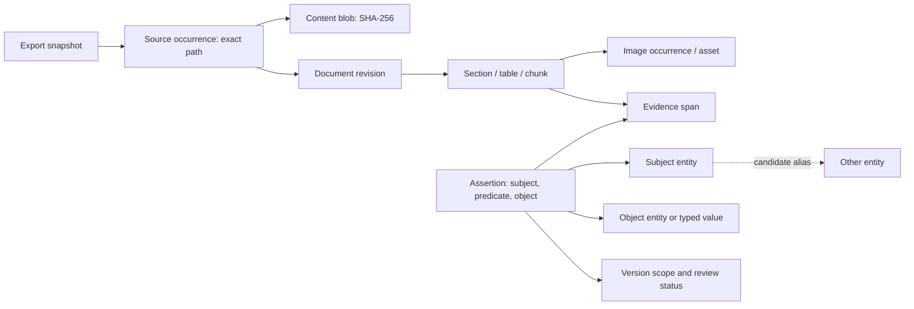
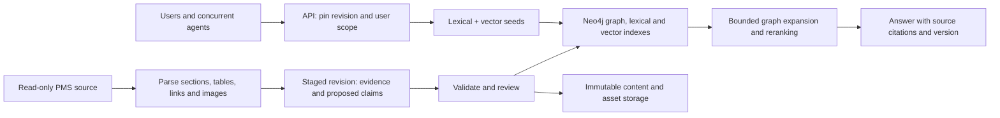

# Graph database stack research for the PMS manual

Research date: 2026-11-07, Europe/Vienna. Status: architecture recommendation, not a deployed database or measured product benchmark. Prepared through primary-source research and corpus inspection; independent review is recorded in `DATABASE_RESEARCH_REVIEW.md`.

Follow-up: `DATABASE_COMPARISON.md` compares all six candidates separately and expands the evaluation scope to all six. Its review is in `DATABASE_COMPARISON_REVIEW.md`; the two-candidate shortlist below records the original recommendation rather than limiting the follow-up comparison.

## Recommendation

For the current corpus and a shared LLM research service, start with **Neo4j + its native full-text/vector indexes + immutable file storage + a Python retrieval/ingestion API**. This gives the project an explicit property graph while keeping retrieval in one database engine. Use Community for an initial single-server evaluation; choose an appropriately licensed Enterprise/Aura deployment if high availability, database roles or operational support are required. Neo4j documents full-text and vector indexes, including their combination for hybrid retrieval; Community is single-instance, whereas Enterprise adds clustering and operational/security features. [Search indexes](https://neo4j.com/docs/cypher-manual/current/indexes/search-indexes/), [editions](https://neo4j.com/docs/operations-manual/current/introduction/).

This is my architectural judgment under an assumed local/private-first, read-heavy deployment. The user has not yet specified hosting, budget, concurrent load or recovery objectives. **PostgreSQL + Apache AGE + pgvector is the strongest alternative** when one transactional store for graph, jobs, evidence and application records, SQL expertise, and open-source licensing matter more than a dedicated graph ecosystem. Benchmark these two before committing to production. A claim that either is universally fastest or optimal would be unsupported.

Prefer **GraphDB** when governed vocabularies, RDF interoperability and formal inference become the central requirement; **Jena/Fuseki** is an open-source RDF variant. Prefer **Neptune** when an existing AWS operating environment makes managed availability worth the additional services and cost. **ArangoDB** deserves consideration for combined document/graph/search workloads, subject to its current commercial terms and transaction scope.

## What the actual data requires

The existing reviewed map records 24,500 source files, 741,945,184 bytes, and a generated German RoboHelp export. A new full scan of HTM files inside the four substantive topic trees found the following. Generated viewer/search trees were excluded from this text profile, while overlapping change logs were deliberately retained.

| Topic tree | HTM files | Approximate text characters | HTML table elements | Image references |
| --- | ---: | ---: | ---: | ---: |
| Main manual | 223 | 11,946,133 | 3,542 | 9,091 |
| Standard interface | 93 | 1,203,578 | 362 | 23 |
| ASCII-spelled change logs | 17 | 1,768,477 | 63 | 613 |
| Unicode-spelled change logs | 18 | 2,115,566 | 77 | 782 |
| Total | 351 | 17,033,754 | 4,044 | 10,509 |

Method: Python HTMLParser, excluding script/style text, joining nonempty text nodes, decoding UTF-8 with replacement on errors. Counts are structural/approximate: tables may be nested or presentational; image references are occurrences, not distinct assets; text includes repeated TOCs and export chrome. Results are in `research/CORPUS_PROFILE.json`, reproducible with `research/profile_corpus.py`. This is not a rendered text, token, section, entity or unique-content count.

Two implications change the design:

1. **A file is too large a retrieval unit.** The configuration appendix alone has approximately 620,201 text characters. Preserve sections, table rows with headers, neighboring explanations and image references. Do not put a whole chapter into one embedding.
2. **Ordinary heading extraction will fail.** The profile found zero native h1-h6 tags in these topic files. A sampled configuration topic uses paragraph classes such as `WD_HBÜ3` and `WD_HBÜ4`. Parse Word-style classes, named anchors and TOC destinations, then validate the reconstructed hierarchy. Do not count every paragraph containing “Überschrift” as a section: table header styles also contain that word.

The reviewed source comparison found 736 corresponding relative paths in the two change-log branches: 463 byte-identical files, 273 different files, plus 444 additional Unicode-branch files. Those are **file** counts, not 273 contradictory business rules. Both branches must retain identity until their actual document content and authority are resolved. See `PROJECT_MAP.md` and `REVIEW.md` for source pointers.

This is a small storage corpus with substantial extraction complexity. Its eventual graph size depends on sectioning, table/field extraction, image interpretation, versions and claim granularity. File count does not establish a need for distributed sharding.

## Graph model: evidence, versions and objects

Use two connected graph layers: a source/document graph and a domain/claim graph. Keep the generated viewer's TOC/hyperlink graph distinguishable from business dependencies. A hyperlink establishes a reference; it does not prove that a PMS module depends on another module.

Recommended records:

| Record | Identity and purpose |
| --- | --- |
| ExportSnapshot | Immutable import identity, source manifest hash, observed time and publication status. Observation time is not the PMS release date. |
| SourceOccurrence | Snapshot plus original relative path, preserving Unicode and case. Each occurrence points to its bytes; two paths may share the same blob. |
| ContentBlob / Asset | SHA-256 and immutable storage URI, size and MIME type; binary bytes remain in files/object storage. Filename alone is never an asset key. |
| DocumentRevision | Logical document identifier plus content identity and branch/version metadata; never silently replace an older revision. |
| Section / Chunk / Table | Revision plus anchor, structural path and offsets; table chunks retain column headings, field codes and units. A chunk is an evidence carrier, not an entity. |
| DomainEntity | Stable, namespaced identity for a module, table, field, instrument type, configuration key, interface record or metric. Similar names are candidates for resolution, not automatic equality. |
| Assertion | A qualified subject-predicate-object claim with evidence, version scope, extractor/model version, observation time, confidence and review state. Confidence is not proof. |
| EvidenceSpan / ExtractionRun | Exact source occurrence/revision, heading/anchor, offsets and extraction method; enables revisiting the source and rebuilding the graph. |

Suggested relations include `CONTAINS`, `REFERENCES`, `DEFINES`, `HAS_FIELD`, `REQUIRES`, `VALIDATES`, `ILLUSTRATES`, `EVIDENCED_BY` and `APPLIES_TO`. Model `SUPERSEDES` and `CONTRADICTS` only after establishing the relevant meaning, version and evidence. A newer filesystem timestamp is insufficient.

An assertion node is important when several documents make the same claim, disagree about it, or apply it to different PMS versions. A bare `A -> REQUIRES -> B` edge cannot conveniently express all of that provenance. Materialize convenient direct dependency edges only as rebuildable projections of reviewed assertions, keeping a link back to their evidence. RDF implementations can use named graphs plus explicit statement/assertion resources and PROV-O; named graphs alone do not provide a complete provenance or access-control policy. [W3C PROV-O](https://www.w3.org/TR/prov-o/), [SHACL validation](https://www.w3.org/TR/shacl/).

### Handling redundancy without losing meaning

- **Identical bytes:** share a blob by SHA-256, retain every occurrence and its path/branch. Storage deduplication does not imply equivalent authority.
- **Identical extracted passages:** reuse an embedding only when the complete embedding input, model, preprocessing and contextual metadata are identical; preserve separate source/evidence links. Group repeated passages when ranking to prevent duplicate results dominating the answer.
- **Near-duplicate passages:** retain separate revisions and record similarity as a candidate relationship. Preserve a one-character field-code or negation change.
- **Same concept, multiple terms:** maintain reviewed aliases scoped by language, product and version. Do not merge tables or metrics merely because their labels resemble each other.
- **Multiple true relationships:** retain typed edges and qualified assertions. Connectedness is useful; uncontrolled duplication of equivalent assertions is not.
- **Contradictory statements:** store both, their scopes and provenance, and return the disagreement when authority cannot be resolved. Unknown version stays unknown.
- **Physical replicas:** improve availability/read capacity; they do not reconcile duplicate knowledge or replace backups.

## Stack options

The rankings below are judgments about fit for this project, not comparative performance measurements. All options use a real graph model and shared server access.

### A. Neo4j with integrated retrieval — recommended baseline

**Components:** Neo4j; native lexical and vector indexes; immutable local content-addressed files initially, or object storage; Python API and ingestion workers; graph visualization client. An optional relational job catalog can be introduced later if application workflow outgrows the graph. No separate vector database is required for the first version.

**Advantages:** dedicated property-graph queries fit version/evidence/entity relationships; search and traversal use common node identifiers; fewer synchronized stores; official GraphRAG retrievers combine vector/full-text seeds with Cypher expansion. [Neo4j GraphRAG retrievers](https://neo4j.com/docs/neo4j-graphrag-python/current/user_guide_rag.html).

**Disadvantages:** graph schema and provenance still require application design; no automatic truth or entity resolution; default read-committed isolation permits nonrepeatable reads; shared-node writes can contend or deadlock. Community is GPLv3 and single-instance; Enterprise capabilities and managed deployment require the appropriate commercial plan. This is a product/edition comparison, not a legal opinion on any proposed redistribution. [Concurrent data access](https://neo4j.com/docs/operations-manual/current/database-internals/concurrent-data-access/), [licensing overview](https://neo4j.com/open-core-and-neo4j/).

**Parallel access:** multiple sessions can execute concurrently, including on one server. In a conventional replicated Enterprise database topology, one elected primary coordinates writes; secondaries add read capacity and may lag. Three primaries provide tolerance of one primary failure; three copies are not three independent writers. Neo4j also documents a specialized sharded Infinigraph edition: do not generalize the conventional topology statement to every product configuration. That scale is not justified by the present corpus. [Cluster architecture](https://neo4j.com/docs/operations-manual/current/clustering/introduction/), [edition distinctions](https://neo4j.com/docs/operations-manual/current/introduction/).

**Choose when:** graph investigation and source-grounded LLM retrieval are the main product, and the team accepts the chosen edition's operational/commercial requirements.

### B. PostgreSQL + Apache AGE + pgvector + PostgreSQL full-text search

**Components:** one PostgreSQL server with AGE for the property graph and openCypher, relational evidence/jobs/metadata, pgvector, native text search, immutable files/object storage and an API. SQL graph tables plus recursive queries are a possible simpler graph implementation if AGE does not pass evaluation, but they require implementing more traversal logic yourself.

**Advantages:** one database transaction can coordinate graph and relational changes; SQL constraints and familiar backup/tooling; MVCC for concurrent readers/writers; PostgreSQL Repeatable Read can maintain a stable transaction snapshot, while Serializable provides stronger coordination with required retries. Open-source licenses reduce dependence on a commercial graph edition. [AGE integration](https://age.apache.org/faq/), [PostgreSQL concurrency](https://www.postgresql.org/docs/current/mvcc-intro.html), [isolation](https://www.postgresql.org/docs/current/transaction-iso.html), [PostgreSQL license](https://www.postgresql.org/about/licence/).

**Disadvantages:** AGE adds its own value type, query integration and optimizer considerations; openCypher support does not guarantee compatibility with every Neo4j feature or procedure. Do not select a PostgreSQL version independently of extension compatibility: the AGE FAQ says up to PostgreSQL 16, while the repository/release information is newer. Pin and test a released PostgreSQL/AGE/pgvector combination and confirm any managed host actually allows AGE. The FAQ also states AGE graph tables cannot currently be distributed via Citus; PostgreSQL availability features do not imply transparent distributed graph writes. [AGE FAQ](https://age.apache.org/faq/), [official repository](https://github.com/apache/age), [release artifacts](https://github.com/apache/age/releases).

**Retrieval caveat:** PostgreSQL full-text ranking is useful but should not be described as built-in BM25. pgvector supports exact and approximate search; approximate-index filters can reduce returned matches because filtering follows candidate scanning. Test version-filtered recall, iterative scans or partitions before adopting ANN. At this corpus size, benchmark exact filtered vector retrieval as the reference. [Full-text search](https://www.postgresql.org/docs/current/textsearch.html), [pgvector filtering](https://github.com/pgvector/pgvector#filtering).

**Choose when:** the team is strongest in SQL, needs significant concurrent application/job records, and accepts an extension compatibility/performance spike. This may beat A on total ownership cost even if A is easier for graph exploration.

### C. ArangoDB with documents, graph, text and vectors

**Components:** ArangoDB, its AQL graph/document/search facilities and vector indexes, immutable assets, and an API. Prefer a single server or an appropriate OneShard design initially.

**Advantages:** flexible JSON evidence records and graph edges in the same model; composable graph/document queries; integrated search can reduce service count. It is attractive when metadata/documents are as central as graph traversal. [Feature overview](https://docs.arango.ai/arangodb/stable/features/).

**Disadvantages:** current Community binaries prohibit commercial production and impose a 100 GiB dataset limit; Enterprise removes these restrictions. Source BUSL terms differ from the binary terms, so do not classify the current packaged product as unrestricted Apache-licensed software. Single-server/OneShard transactions and general distributed multi-server transactions have different guarantees. Vector indexes are trained; changes to the embedding distribution can degrade quality and warrant rebuilding. [Edition terms](https://docs.arango.ai/arangodb/stable/features/), [transaction limitations](https://docs.arango.ai/arangodb/stable/develop/transactions/limitations/), [vector indexes](https://docs.arango.ai/arangodb/stable/indexes-and-search/indexing/working-with-indexes/vector-indexes/).

**Parallel access:** supported server clients do not imply conflict-free writes; keep transactions small. Validate exact deployment mode and failure semantics before relying on graph-plus-document atomicity across shards.

**Choose when:** one-engine document/property-graph flexibility wins a proof of concept and the commercial license is acceptable. It is a credible option, but its licensing and cluster semantics make it a less straightforward default here.

### D. RDF knowledge graph: GraphDB, or Jena/Fuseki

**Components:** GraphDB + OpenSearch/Elasticsearch connector + assets + API; or Apache Jena Fuseki/TDB2 + a separate vector/text service such as PostgreSQL/pgvector. Use shared IRIs, controlled predicates, named graphs, provenance records and validation shapes.

**Advantages:** strong fit for integrating formal definitions, governed terminology and evidence across many manuals/systems; RDF/SPARQL and PROV-O make interchange explicit. SHACL can validate graph structure. This is the strongest conceptual alternative if the eventual goal is an enterprise semantic reference model rather than primarily a manual assistant. [PROV-O](https://www.w3.org/TR/prov-o/), [SHACL](https://www.w3.org/TR/shacl/).

**GraphDB tradeoffs:** formal modeling and SPARQL skills are needed; materialized inference increases ingestion/storage work; external vector/search connectors add another consistency boundary. GraphDB 11.5 documents read-committed isolation and sequential updates/commits alongside parallel readers; it does not promise a whole multi-operation transaction reads one snapshot. Validate license and cluster edition separately. Its documented vector route includes Elasticsearch/OpenSearch connectors; this is not a claim of same-engine atomic graph/vector updates. [Transactions](https://graphdb.ontotext.com/documentation/11.5/storage.html), [vector connector](https://graphdb.ontotext.com/documentation/11.5/elasticsearch-graphdb-connector.html).

**Jena tradeoffs:** TDB2 offers serializable MVCC transactions and concurrent readers, but one active writer. Queue imports behind Fuseki; do not let multiple processes/JVMs open the same database directory. It is an attractive open-source baseline for periodic documentation ingestion, with more operational/integration work than a packaged managed stack. [Jena transactions](https://jena.apache.org/documentation/tdb/tdb_transactions.html).

**Choose when:** standards, ontology, semantic validation and cross-system integration outweigh the additional modeling and retrieval integration work. Inference must be scoped to reviewed/version-compatible assertions; it cannot determine whether an outdated manual statement is true today.

### E. AWS Neptune Database + S3 + OpenSearch

**Components:** Neptune Database for graph, S3 for immutable assets/manifests, OpenSearch for keyword/vector retrieval, API/workers and a version-aware publication coordinator. Use the appropriate Neptune graph/query model; do not assume a Neo4j application or procedures are portable unchanged.

**Advantages:** managed database infrastructure, failover and read scaling can fit an established AWS platform. Neptune Database has one writer and up to 15 read replicas. Read-only queries use MVCC snapshot semantics; replicas can be behind the writer. [Cluster architecture](https://docs.aws.amazon.com/neptune/latest/userguide/feature-overview-db-clusters.html), [transaction isolation](https://docs.aws.amazon.com/neptune/latest/userguide/transactions-neptune.html).

**Disadvantages:** more services, networking and cloud-specific operation; graph and search publication must be coordinated; one writer remains and mutations can encounter range-lock conflicts requiring retries. Session mode matters: read queries in Gremlin standing sessions and openCypher Bolt read-write sessions use mutation-query isolation on the writer, so the snapshot statement above does not apply to every session. It is difficult to justify purely from this dataset's size. Managed infrastructure removes some administration, not graph modeling or retrieval evaluation. [Session/isolation distinctions](https://docs.aws.amazon.com/neptune/latest/userguide/transactions-neptune.html).

**Important product boundary:** Neptune Analytics is a different engine. Its vector-index changes are documented as non-atomic and non-isolated, unlike other graph changes; do not apply Neptune Database ACID claims to these vectors. If Analytics is introduced, treat it as a separately published derived projection. [Analytics vector transaction limits](https://docs.aws.amazon.com/neptune-analytics/latest/userguide/vector-index.html).

**Choose when:** AWS availability/security/operations requirements already exist and justify the additional service footprint.

## Parallel readers, writers and deep queries

These are separate workloads: many agents reading, parallel extraction workers, concurrent publication/review writes, and expensive graph analysis. A server can accept many connections while still saturating on a few unconstrained traversals. A single elected writer is also not the same as permitting only one client transaction at a time.

| Stack | Read/write behavior to design around | Main concurrency risk |
| --- | --- | --- |
| Neo4j | Concurrent transactions; read committed by default; write locks; conventional cluster has one write coordinator per database and read replicas. | Same-entity writes, deadlocks, nonrepeatable reads, replica freshness. |
| PostgreSQL/AGE | MVCC; concurrent writes with conflict handling; select isolation intentionally. | Hot rows, long transactions, extension query plans, serializable retries. |
| ArangoDB | Concurrent clients; isolation/atomicity depend on deployment and transaction scope. | Cross-shard failure semantics, transaction size, conflicts. |
| GraphDB | Parallel readers, sequential updates/commits, read committed. | Ingestion queue/inference work and assumptions of repeatable snapshots. |
| Jena TDB2/Fuseki | Multiple readers, one active writer, serializable transactions. | Writer queue, incorrect direct multi-process file access. |
| Neptune Database | One writer plus read replicas; snapshot read-only queries; locking for mutations. | Range conflicts, replica lag, independent search projection. |

The behavior above follows the product transaction/cluster sources cited in each option. No throughput limit is inferred from these descriptions.

For the recommended baseline:

1. Share the server through an API. Reuse a driver/connection pool per process; give each concurrent request its own session/transaction. Neo4j sessions are not thread safe; its asynchronous driver supports concurrent workflows. [Driver sessions](https://neo4j.com/docs/python-manual/current/transactions/), [async concurrency](https://neo4j.com/docs/python-manual/current/concurrency/).
2. Perform parsing, image processing, embeddings and LLM extraction outside database transactions. Queue independently retryable jobs keyed by content hash, parser/chunker/extractor versions, model and configuration. Lease jobs so workers do not publish the same work twice.
3. Enforce unique identities and idempotent upserts. Bound retries with backoff for transient conflicts; order shared-entity updates consistently. Avoid every worker updating one shared progress node.
4. Build a staged immutable dataset revision. Validate source resolution, entity IDs, assertions and required indexes; wait for asynchronous index refresh where applicable. Publish the active revision only after it is queryable.
5. Pin that revision once per user request and use it for every graph/text/vector fetch. With replicas, confirm the published revision is readable using bookmarks/appropriate routing. Keep old revisions available for in-flight requests. Immutability plus revision predicates provides application consistency; read committed alone does not provide a request-wide snapshot.
6. In a multi-store stack, use durable projection jobs/outbox, reconciliation and a readiness manifest. A manifest that merely says “ready” is insufficient: readers must actually filter every store to the pinned revision. Publish only after all required projections pass checks. No cross-store ACID guarantee is assumed.
7. Bound API work queues, connection pools, expansion budgets and transaction/query timeouts. Apply version and permission filters to both seeds and graph expansion. Cache by revision, query and user scope. Database roles/tenancy must match the edition and deployment selected.

### How to handle deep and highly connected graphs

Support deep dependency analysis, but distinguish **reachable nodes**, **shortest explanations**, and **every possible path**. The latter can grow explosively even on a moderate graph. Neo4j explicitly recommends bounded patterns and early predicates to avoid path explosion; returning `LIMIT 10` after enumerating paths is not a sufficient work budget. [Variable-length path guidance](https://neo4j.com/docs/cypher-manual/current/patterns/variable-length-paths/).

Use indexed entity/chunk seeds, explicit edge types, direction and version scope. For interactive retrieval, begin with 1–3 domain hops, a visited-node policy and bounded fan-out; tune these as evaluation parameters, not universal limits. Permit deeper transitive closure in queued analysis jobs with cycle handling, a node/edge/work budget, timeout and explicit reporting of truncation. Return a compact supported subgraph and source excerpts. Deduplicate reachable nodes rather than enumerate all paths unless path identity is the actual question. Optional closure projections can be built per immutable revision and invalidated with that revision.

## Retrieval and ingestion plan

1. Inventory and hash the complete export; classify content versus generated viewer resources. Keep navigation metadata for structure, but do not embed thousands of generated search pages as independent knowledge.
2. Extract German text, anchors and Word-style headings; keep original source pointers. Separate TOCs from body text. Preserve table headers, units, field identifiers and meaningful surrounding prose. Reconstruct tables carefully before turning rows into facts.
3. Link image occurrences using exact paths and content hashes. Inspect ER diagrams/screenshots when they carry information missing from text; OCR or visual extraction remains provisional and cited to the original image.
4. Build section-aware chunks. A 400–900-token starting window with modest overlap can be evaluated, but tables and definitions should override arbitrary window boundaries. Token counts and embedding costs must be measured with the chosen tokenizer/model; character totals are not exact token totals.
5. Extract a controlled set of entity/relationship types. Keep model-proposed assertions separate from reviewed assertions. First load deterministic containment/link relationships, then add domain claims with evidence.
6. Retrieve exact identifiers/terms and semantic candidates, combine ranked lists, then expand the graph around the candidates. Test German stemming, compounds, abbreviations and technical identifiers separately. Do not add raw lexical scores to cosine scores. RRF is one starting fusion method; evaluation decides whether it helps. [Neo4j hybrid search](https://neo4j.com/docs/cypher-manual/current/indexes/search-indexes/), [OpenSearch RRF](https://docs.opensearch.org/latest/vector-search/ai-search/hybrid-search/rrf/).
7. Return exact path, document/branch/version when known, heading/anchor and supporting passage/image. If the graph lacks evidence or branches disagree, make the gap visible.

Start with native search in A. Add **OpenSearch** if measured relevance/features need specialized lexical processing; add **Qdrant** if vector scale or operational isolation warrants a dedicated vector service. Either adds publication, monitoring and backup responsibilities; Qdrant distributed mode does not automatically replicate existing data merely because cluster mode is enabled. [Qdrant distribution](https://qdrant.tech/documentation/distributed_deployment/). Avoid installing both by default.

## How to decide with evidence

Create the same frozen extracted dataset and workload for A and B; include C or D only if their distinguishing benefits are relevant. Do not compare different chunking/embeddings and attribute the outcome to the database.

| Test family | Cases tied to this corpus | Record |
| --- | --- | --- |
| Exact retrieval | Configuration keys, table/field names, interface codes, German compounds and acronyms. | Recall@k, precision and wrong-version matches. |
| Graph retrieval | Module-to-configuration-to-interface dependencies; table/field lookup; 2, 4 and 8-hop queries plus high-degree/cyclic cases. | p50/p95/p99 retrieval latency, nodes/edges visited, timeouts and correctness against reviewed evidence. |
| Redundancy/version | Both change-log branches, identical assets at different paths, near-identical passages with changed field code/negation. | Provenance retained, conflicting claims surfaced, duplicate result concentration. |
| Parallel access | 10, 50 and 200 simultaneous API requests, first read-only then mixed with 1/4/8 ingestion workers. These are proposed stress tiers, not promised capacity. | Throughput, queue time, tail latency, CPU/RAM/I/O, lock waits, retries and errors. |
| Publication/failure | Interrupt an import; crash a worker after a committed batch; kill a projection update; query through publication. | No duplicate IDs, no half-published revision, recoverable jobs, no mixed graph/vector versions. |
| Restore | Restore source manifest, blobs, graph and index metadata; rebuild derived search and replay a fixed query set. | Recovery time, lost revisions and reproduced citations. Replication alone does not test this. |

Begin with 50–100 human-reviewed questions spanning the table above. Separate retrieval latency from embedding/reranker/LLM latency, test warm and cold conditions, and record model/version/hardware. An example provisional target is p95 retrieval below one second at the chosen normal concurrency, excluding generation; agree on the real target before treating it as a pass criterion. No performance results were measured in this research.

For an initial benchmark, an SSD-backed server with roughly 4–8 CPU cores and 16–32 GiB RAM is a test envelope, not a sizing guarantee. Isolate embedding/LLM inference from the database measurements. Final memory depends on graph/index sizes, vector dimensions, live revisions and concurrent query working sets. As a simple illustration, 20,000 float32 embeddings of 1,024 dimensions occupy about 78 MiB of raw vector values; this excludes indexes, graph, text, replicas and overhead and does not predict the actual chunk count.

## Ownership cost and final choice rules

Compare annual software/managed-service charges, compute/storage/replicas, backups, extraction/model use, engineering time, upgrades and on-call work. Open-source license cost is not total cost. Enterprise graph prices depend on the selected plan; request a current quote once availability/support requirements are known. No monetary estimate is fabricated here. [Neo4j current pricing/plans](https://neo4j.com/pricing/).

| Priority that actually governs the project | Prefer |
| --- | --- |
| Fast path to a graph-oriented manual assistant with inspectable relations | A: Neo4j integrated retrieval |
| SQL operations, open-source components and consolidated application transactions | B: PostgreSQL/AGE/pgvector, conditional on the compatibility/query spike |
| JSON/document-first graph with integrated search and accepted commercial terms | C: ArangoDB |
| Formal ontology, governed knowledge exchange and inference | D: GraphDB; Jena/Fuseki when open-source and queued writes fit |
| Existing AWS platform plus managed availability/read scaling | E: Neptune Database/S3/OpenSearch |

**Recommended next decision:** evaluate A and B on the same evidence/version model. Choose A if graph development and retrieval quality are strong without extra stores; choose B if it meets the traversal workload and materially simplifies operations/cost. Add a cluster because of measured demand or recovery objectives, not because multiple agents need access. Preserve the source as read-only in every option.

Research establishes product capabilities and an evidence-based shortlist, not a purchased license, verified deployment, complete extracted domain graph or benchmarked winner. Source documents were not modified. No database was deployed, paid resource provisioned, or source corpus sent to an external ingestion/embedding service during this research.
