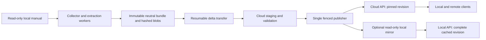

# Implementation outline: portable manual knowledge service

Date: 2026-11-07 (Europe/Vienna). Status: target implementation contract; an initial local capture/extraction/validation slice exists, while the full service remains unimplemented and unvalidated. Current progress is tracked in `PROJECT_TRACKER.md`; executable scope is in `IMPLEMENTATION_STATUS.md`. No project database has been selected, deployed or benchmarked. All six candidates remain in evaluation. This document makes a provisional engineering recommendation for the user's newer priorities; it does not turn prior research into measured results.

## 1. Outcome, evidence and recommendation

Build an open-source-oriented service that updates the manual incrementally, transfers changed data from local storage to cloud efficiently, and serves cited graph-assisted retrieval through the same API locally and remotely. Keep `root_manual` and its external target read-only. Begin with engine-neutral extraction and synchronization contracts before committing to a database.

Verified prior evidence is in [PROJECT_MAP.md](PROJECT_MAP.md), [REVIEW.md](REVIEW.md), [DATABASE_RESEARCH.md](DATABASE_RESEARCH.md), [DATABASE_RESEARCH_REVIEW.md](DATABASE_RESEARCH_REVIEW.md), [DATABASE_COMPARISON.md](DATABASE_COMPARISON.md), [DATABASE_COMPARISON_REVIEW.md](DATABASE_COMPARISON_REVIEW.md) and [CORPUS_PROFILE.json](research/CORPUS_PROFILE.json). The source junction was rechecked for this outline. The dated inventory/profile was read, not fully rerun: 24,500 files/741,945,184 bytes overall and 351 topic HTM files; diagnostic text/table counts retain duplicates. Extraction must recover Word-style headings, tables, images and exact Unicode source identities. These observations do not establish a live PMS schema.

**Provisional recommendation:** use a Python application and workers, immutable neutral bundles, local content-addressed files with an object-storage adapter, and evaluate PostgreSQL + Apache AGE + pgvector + native full-text search first. Consolidating revision catalogs, jobs, evidence, graphs and retrieval is a plausible maintenance benefit, conditional on released extension compatibility, graph correctness and operational tests. Start vector evaluation with exact filtered search; adopt approximate indexes only if measured need and recall justify them. No Kafka, Kubernetes, separate vector engine or separate search engine is required by this outline.

The updated priority is open-source components and maintainable updates, rather than the earlier private graph-first assumption that provisionally favored Neo4j. This change of recommendation is a design judgment, not a newly benchmarked winner. The neutral bundle and adapter interfaces protect all-six evaluation without implementing six production backends prematurely.

| Candidate retained | Place in this implementation evaluation | Gate that could change recommendation |
| --- | --- | --- |
| PostgreSQL + AGE + pgvector | First compatibility and maintenance spike; provisional baseline | Released compatible versions, transaction behavior, filtered retrieval and bounded graph plans |
| Neo4j + native full-text/vector | Dedicated property-graph alternative | Chosen edition/license and recovery/security features fit; simpler graph work outweighs consolidation |
| Apache Jena Fuseki/TDB2 + separate retrieval | Open-source RDF alternative | RDF/ontology requirement justifies another retrieval service and queued graph writer |
| ArangoDB + integrated retrieval | Document/graph alternative | Exact distribution/license fits use; trained vector lifecycle and deployment transactions pass |
| GraphDB + OpenSearch/Elasticsearch | Semantic governance alternative | Formal inference/ontology benefits justify licensing and projection operations |
| Amazon Neptune Database + S3 + OpenSearch | Managed AWS alternative | Existing AWS requirements outweigh local-engine parity and vendor dependency |

The six candidates are not all wholly open-source stacks. Existing comparison documents contain product/license sources and limits; exact release licenses must be rechecked at Gate 1. No candidate is silently removed by the OSS preference. No claim is made that a managed cloud product can run its engine locally; all candidates can share the neutral data/API contract, while actual disconnected access depends on a validated local implementation.

## 2. Deployment and access model

Use one logical authoritative publisher per dataset. Multiple extraction workers may prepare data, but only its fenced publication coordinator changes the active revision. First run an isolated local prototype; after a cloud trial, the cloud service becomes the authority and the local collector sends bundles to it. Cutover stops old publication, verifies the destination, transfers authority and updates clients; it is not active-active database synchronization.

Authority cutover is a controlled maintenance operation: disable the old publication endpoint and revoke its publisher credentials; export the final catalog generation and retained manifests; establish a higher authority epoch and new publisher identity in the trusted receiver/client configuration; import and verify the destination; then redirect clients. Receivers reject publication commands from the old authority even if its local catalog still accepts them. Independent catalogs cannot fence each other merely by incrementing a local number. If old authority shutdown/revocation cannot be established, stop cutover; recovery must not reactivate both publishers. Record and authenticate the authority handoff alongside the catalog backup.

Default connected operation: local desktop/browser clients and remote clients use the authenticated cloud API. A local-only installation exposes the same API on loopback. A cloud outage returns a clear availability error unless the optional offline profile is enabled.

Optional offline profile: maintain a separately built, read-only local serving mirror from the last complete published bundle. Local and cloud may serve different explicitly identified revisions; the UI displays revision and last successful synchronization. A mirror never publishes back or edits the authoritative dataset. Switching to a mirror is explicit or clearly indicated, with its own readiness checks. Full offline generation additionally requires local embedding/reranking/generation models; otherwise the offline profile offers retrieval and citations only. Database replication is not the interchange format.

Offline access requires an explicit dataset/device policy: encrypt the local cache, bound the cached authorization validity, and refuse access after expiry until online revalidation. Immediate remote revocation cannot be guaranteed while disconnected. A policy requiring immediate revocation disables offline access. A stale mirror must report its revision and freshness; it must not claim to reflect the current cloud publication. Source preparation can remain local after cloud authority cutover, but only the cloud publisher may authorize a new publication at that stage.

Each serving location enforces its own reader leases and retention catalog. Cloud leases cannot protect a disconnected local request; the mirror pins its locally complete revision and serializes its own GC with local lease admission. Cloud retirement never directly deletes mirror files. Reconnection applies policy/revocation checks before new access and imports a complete revision before changing the local active pointer. Offline permission grants remain scoped and time-bounded independently of data-revision retention.



## 3. Neutral data contract

Use schema-versioned UTF-8 JSON manifests and deterministic JSONL records; blobs use SHA-256 keys. Serialization rules, numeric encoding, line endings and sorting must be fixed by golden fixtures before digest identities become durable. Compress transferred record segments deterministically; never let a compression timestamp change logical IDs. Hash both logical payload and transported object where needed, with explicit encoding metadata.

| Record | Required identity/content |
| --- | --- |
| Bundle manifest | Schema version, dataset ID, parent revision, complete occurrence inventory, referenced record segment/blob hashes and lengths, parser/extractor/model/config versions, counts and validation summary |
| Source occurrence | Dataset namespace, exact relative path, branch, blob hash, source observation metadata; preserve Unicode/case without silently normalizing distinct names |
| Document revision/section/table/chunk | Source occurrence, blob identity, structural locator/anchor, heading ancestry, table headers/units and extraction version |
| Evidence span | Occurrence and document revision, extraction-output offsets plus mapping to original source locator, optional image path/hash and inspected status |
| Entity/assertion | Namespaced IDs, typed relations/values, explicit source/version scope, evidence IDs, extraction run and review state; unknown PMS version stays unknown |
| Membership/projection | Dataset revision membership, graph/text/vector projection versions, expected counts/digests and readiness evidence |
| Publication record | Revision digest, monotonic publication generation, previous active revision, publisher fencing epoch, verified readiness and audit actor/time |

Distinguish the complete dataset revision from PMS version and from publication generation. A rollback changes publication generation while selecting an older dataset revision. Compute dataset revision identity from the canonical manifest content excluding its own ID/signature and mutable publication state; publisher metadata is separate.

Source occurrence identity is path-scoped; an unchanged blob at two paths retains two occurrences. A rename creates a new occurrence and removes the old occurrence from the new revision, reusing bytes and extraction caches where their complete input keys match. A suspected rename may be reported as a candidate mapping, never inferred as semantic equality. Deletion is absence from a verified complete new inventory plus an explicit delta removal; old published revisions retain their original membership. Missing/unreadable source roots or partial scans abort publication and never imply mass deletion. Both change-log tree spellings remain distinct.

## 4. Incremental update and transfer protocol

1. **Capture:** read the external source only; write all manifests/cache/state outside it. Do not follow arbitrary source reparse points outside the configured read boundary. Inventory exact paths; stat before and after reads, retry unstable files and compare a final inventory. Ordinary filesystem reads cannot guarantee a coherent multi-file snapshot. Require a quiescent export or an approved read-only snapshot for a consistent release; otherwise mark the scan incomplete and do not publish it as complete.
2. **Detect:** use metadata as a scan hint, not proof of unchanged bytes. Hash complete snapshots for authoritative changes; any optimized unchanged-file cache needs periodic full verification and a documented trust policy. Additions/changes/deletions derive from the previous complete manifest. Size/mtime alone cannot establish equivalence.
3. **Extract:** process only changed complete cache keys: blob hash plus parser/chunker/extractor configuration, contextual input, model/tokenizer revision and embedding dimension. Preserve occurrence-specific context even when bytes share caches. Review/OCR corrections create new artifacts and a new dataset revision; they do not mutate published claims.
4. **Package:** write immutable moderately sized deterministic record segments, then a small complete inventory/manifest. Reuse unchanged segments and blobs rather than rebuilding one monolithic archive. Determine segment size from transfer measurements; retain a full logical snapshot even when transport is a delta.
5. **Negotiate:** authenticated receiver returns the missing hash set for an upload session, scoped to this dataset and principal. Do not expose cross-tenant object existence. Recheck referenced objects at finalization even when the sender thinks they exist.
6. **Transfer:** upload missing objects with bounded concurrency, resumable multipart or chunk support where the backend supports it, timeouts, checksums and bounded exponential backoff. Initial full transfer has no speed promise. A no-change update transfers only protocol/manifest metadata; a one-file update transfers only new/recomputed objects and small metadata, unless the extraction configuration requires a rebuild.
7. **Validate:** verify lengths and cryptographic hashes after completed transfer, completeness of the inventory, schema/identity/evidence constraints and permitted paths. A completed upload is not publication. Corruption, unexpected base revision or exhausted retries leaves staging quarantined and the old active revision intact.
8. **Build and publish:** materialize required graph/text/vector projections under the new immutable revision, verify readiness, then atomically change the catalog pointer as specified below. Reconciliation can rebuild derived projections from the neutral bundle.

A reconnect resumes the same idempotent session. An outdated parent revision returns conflict; the publisher must explicitly rebuild/rebase against the active parent, never overwrite another publication. Object-store ETags are not assumed to be SHA-256. Store readers verify declared checksums; a trusted publisher signature or authenticated catalog binds the manifest to its owner. Hashes alone provide integrity, not authorization.

## 5. Publication, concurrency and retention

Proposed states: `captured -> staged -> validated -> ready -> published`; failures become `failed`/`quarantined`, with retryable attempts recorded separately. Publication history is append-only; an old revision can remain ready/retained after its active status changes. Keep parsing, embeddings and slow object transfer outside database transactions.

Workers claim jobs using a time-bounded lease and monotonically increasing fencing token. Job identity includes dataset, stage and complete input digest. Lease renewal requires current ownership; commits require the current fencing token, so a stalled worker cannot commit after another worker acquires the job. Uniqueness constraints/idempotent writes prevent duplicate results; a lease by itself does not provide exactly-once execution.

The publication transaction locks/compares the catalog generation and expected parent, verifies the publisher fencing epoch and required readiness records, writes the publication audit record and swaps the active pointer atomically. A crash before commit leaves the old pointer; a crash after commit is reconciled by reading generation, rather than publishing twice. A readiness record must be tied to exact projection generation/digest and validated through the serving endpoint. For multi-store candidates use durable outbox/projection jobs and reconciliation, not an assumed distributed transaction. Route reads only to endpoints proven ready for the pinned revision.

At request admission, atomically pin a readable revision and acquire its bounded reader lease against the retention catalog. Every graph, lexical, vector, asset and cache lookup uses the same revision and authorization scope. Propagate the pin through reranking/generation/citation resolution. Timeout or cancel requests before their lease expires unless renewed; never silently change revision mid-answer. Long exports/background jobs need renewable leases too. Return a retryable unavailable response if a required projection is missing, rather than mixing revisions.

Default retention proposal: retain active revision, previous two successful revisions and all leased or operator-held revisions; use a seven-day minimum grace period until storage measurements justify changes. The retention lock must serialize reader-lease admission with marking a revision for retirement: marked revisions refuse new pins, existing leases drain, then deletion may proceed. A two-phase garbage collector computes reachability from retained manifests across shared blobs/projections, waits through the grace period, rechecks leases/references, then deletes only unreferenced artifacts. Interrupted staging has its own expiry and cannot delete shared blobs. Revision retirement may make old API citation URLs unavailable; document retention in the UI and support durable exported citation bundles for long-term use.

Active upload, staging and import sessions are also garbage-collection roots. Their renewable leases protect declared and newly accepted objects until the publication transaction transfers protection to a retained revision, or the session expires and its grace period drains. Register protection before acknowledging an upload. Serialize the final GC reference check with session admission/renewal and publication; never delete an object based only on an earlier reachability scan. An expired session must reacquire protection and revalidate object presence before resuming.

Rollback is a new audited compare-and-swap publication to a retained, fully ready revision; invalidate active-revision caches and let existing pinned requests finish. It does not undo source edits or external side effects. Restore drills must recover manifests, objects, review records, identities, publication catalog and configuration/model provenance, then rebuild indexes and replay citations. Replication alone is not backup.

## 6. Modules and repository outline

The following paths are a proposed skeleton, not existing service implementations. Create modules only as each milestone needs them. Keep current research and memory in place; runtime data, downloaded models, source copies and secrets remain untracked outside `root_manual`.

```text
src/manual_knowledge/
  contracts/       # versioned manifests, records, API types and validation
  source/          # read-only capture, path boundary checks and change detection
  extraction/      # Word-style headings, tables, links, evidence and image workflow
  bundles/         # canonical encoding, hashes, immutable segments, import/export
  storage/         # local files and object-store transport adapters
  jobs/            # leases, retries, fencing and reconciliation
  catalog/         # revision membership, publication, reader leases and retention
  adapters/        # engine interface; baseline first, evaluation adapters later
  retrieval/       # lexical/vector fusion, bounded traversal, citations
  api/             # authentication, authorization, queries and update control
  cli/             # scan, build, sync, validate, publish, rollback, restore
tests/
  fixtures/        # synthetic/public fixtures; no copied confidential manual
  contracts/       # cross-adapter identity and publication requirements
  integration/     # real pinned engine and storage compatibility
  failure/         # crashes, races, corruption, timeouts and recovery
evaluation/        # reviewed questions, six candidate sheets and workload runner
ops/               # version locks, local/cloud profiles and tested runbooks
```

One application package and one worker command are sufficient initially. Run the same tested container/image on local Linux-compatible runtime and a cloud VM only after verifying host/runtime support; native Windows database/extension parity is not assumed. Start with a single private server topology without claiming HA. Adopt managed PostgreSQL only after the provider confirms the exact required extensions; otherwise compare self-hosting effort with the alternatives. Object storage is an interchangeable transport/storage boundary, not evidence that every S3-compatible implementation has identical semantics.

## 7. Proposed API and adapter contracts

All mutation endpoints require an authorized operator/publisher role; readers cannot upload, publish or choose arbitrary storage URLs. Version the API. Inputs and responses carry request ID, dataset scope and explicit error code. Idempotency keys are bound to principal, dataset, endpoint and payload digest; reuse with different content returns conflict.

| Contract | Inputs and outputs / invariants |
| --- | --- |
| `POST /v1/datasets/{id}/uploads` | Manifest digest/schema and expected parent; returns session, expiry and missing-object list; no publication |
| `PUT /v1/uploads/{session}/objects/{hash}` | Stream/resumable transfer; validates expected size/hash; completion is idempotent |
| `POST /v1/uploads/{session}/finalize` | Revalidates complete manifest/references; returns revision and validation job |
| `GET /v1/jobs/{id}` | State, progress counters, retryability and sanitized failure details |
| `POST /v1/datasets/{id}/publications` | Ready revision, expected active generation and idempotency key; returns new generation or conflict; publisher fencing enforced server-side |
| `GET /v1/datasets/{id}/status` | Active revision/generation, readiness and last verified sync; authorized metadata only |
| `POST /v1/query` | Query, dataset, optional retained revision, scope/filters and budgets; returns pinned revision, cited evidence, confidence/review labels and truncation reason |
| `GET /v1/revisions/{rev}/evidence/{id}` | Authorized source locator and safe rendering/asset reference, consistently pinned; never executes manual scripts |
| `POST /v1/datasets/{id}/rollback` | Retained ready revision and expected generation; audited publication semantics |

Adapter operations: `stage_revision`, `validate_revision`, `readiness`, `lexical_candidates`, `vector_candidates`, `expand_graph`, `fetch_evidence`, `retire_revision`. Every read takes revision and authorization scope; every expensive query takes a timeout/work budget. RDF adapters preserve qualified assertion resources/named graphs and property-graph adapters preserve assertion nodes; identical semantic inputs do not imply identical physical schema. Export is always possible from the neutral bundle even if engine export formats differ.

## 8. Security and maintainability defaults

Bind local development to loopback. Cloud access uses TLS and authenticated API sessions behind private networking or an authenticated gateway; never expose database ports publicly. Separate reader, worker and publisher permissions. Authenticate/authorize object fetches and synchronization; do not place signed URLs or tokens in manifests/logs. Encrypt backups and configure storage access narrowly. Cloud region, source redistribution rights and external model processing remain deployment gates; no upload or remote embedding is performed by this outline.

Treat HTML and model output as untrusted. Sanitize displayed text/HTML, disallow source script execution and outbound fetches during parsing, constrain archive/path extraction and MIME/size limits, and reject traversal paths. Manual text cannot instruct tools to execute code. Enforce authorization before retrieval and again on evidence fetch; caches include permission scope. Use synthetic fixtures in source control and keep full manual data out of public repositories.

Lock runtime/library dependencies and database/extension images by exact release and digest after Gate 1. Record OS/architecture, PostgreSQL, AGE, pgvector, driver, migration, parser, tokenizer/model revision, vector dimension and index configuration together. An upgrade creates a staging revision/build, runs compatibility, recall and restore tests, then receives a new publication; retain a tested rollback image/data path. Do not downgrade data files in place after an incompatible engine upgrade.

Expose structured metrics: scan/hash/extraction/embedding/index/transfer durations; changed and reused bytes; bytes actually sent, retried and verified; sync lag; publish failures; stale leases; queue depth; graph work/truncation; citation/revision errors; p50/p95/p99 query times; disk usage per retained revision; backup age/restore time. Record monthly hosting/storage/egress/model cost and maintenance hours separately. Redact source passages and credentials from routine logs. No cost or latency figure is presently measured.

## 9. Milestones and acceptance gates

| Gate | Deliverable | Required evidence before progressing |
| --- | --- | --- |
| 0: design review | This outline, all-six priorities, issue ledger | Independent review/evaluation; no open blocking design contradictions; unknown external decisions explicitly gated |
| 1: compatibility | Version/license matrix and tiny isolated candidate spike; six candidate qualification sheets | First test a released PostgreSQL/AGE/pgvector combination, mixed graph/SQL rollback, bounded queries and backup/restore; actual host permits extensions. If it fails, document failure and qualify another retained candidate. Neutral pipeline work can continue independently; record pass/fail/untested for every candidate. |
| 2: neutral pipeline | Capture, extraction, bundles and local validation | UTF-8/Unicode fixtures, both branches, table/heading/image evidence, duplicate paths, rename/delete, partial scan rejection and deterministic reruns pass |
| 3: reliable updates | Local receiver then authorized cloud trial using same protocol | No-change and small-change transfer measured; interrupted/corrupt/replayed transfers recover; source stays read-only; wrong-parent publication rejected |
| 4: serving | Authenticated API, baseline graph/text/vector retrieval | Correct citations, permission boundaries, pinned revisions, bounded cycles/fan-out and exact filtered-vector reference; mirror tests if enabled |
| 5: fair selection | Six empirical result sheets on one frozen dataset/workload | Same evidence/embeddings/questions; correctness first; explicitly mark inaccessible/unlicensed tests unrun rather than invent ranking; no final selection until required evidence is available |
| 6: operations | Restore/upgrade/rollback and deployment runbooks | Crash/recovery drills, retention races, backup restoration, operator update rehearsal and agreed capacity/recovery/cost targets |

Mandatory failure tests include: source root missing; source changes during scan; Unicode/case identity collision; content-identical rename; deletion while old request reads; late worker after lease expiry; simultaneous publication attempts; commit acknowledged/lost response; search projection delayed; object corrupted; revision pin versus garbage collection race; interrupted mirror import; schema/model upgrade; cold restore without any original database files. Pass means no mixed revision, missing referenced evidence, unauthorized read, duplicate semantic identity from retry, or unintended source write. A test specification is not a passed test.

Use 50–100 reviewed questions spanning exact codes, German terminology, table fields and branching version conflicts. S05 supplies a source-backed three-edge dependency chain; expanded 2/4/8-hop cyclic/high-degree stress graphs are synthetic unless separately supported by reviewed manual evidence. Preserve prior 10/50/200 concurrent-reader and 1/4/8-worker tiers as proposed stress tests, not promised capacity. Measure native retrieval and controlled shared candidates separately, and distinguish database latency from model latency. Initial small fixtures should be cheap; production hardware sizing follows measurements.

Use `SOURCE_TEST_CASES.md` as the source-derived seed corpus for these questions and process checks. Its expected answers test faithful retrieval of documented PMS rules; they are not executable validation of a running PMS installation. Keep synthetic crash, race and mutation fixtures separately labeled. Every candidate must preserve the same evidence and version semantics before speed or maintenance comparisons are accepted.

Measure destination work independently of delta transport: reused versus rebuilt graph records and embeddings, index-build duration, peak staging/retained-revision disk usage and operator intervention. Begin with the simplest correct staged import; physical projection reuse is an optimization requiring immutable membership and isolation tests. A small source delta may still require a complete index rebuild, and the candidate evaluation must report that cost.

## 10. Unresolved inputs and working defaults

| Input not established | Working default for design | Required before |
| --- | --- | --- |
| Meaning of local access/offline need | Local and cloud clients share cloud API; optional complete read-only mirror | Enabling automatic offline operation |
| Cloud account, region, rights and data classification | Keep all real corpus/model processing local; no external transfer | First real upload or remote model call |
| Source update process and authoritative branch/version | Manual trigger on a quiescent export; retain both branches, unknown version allowed | Claiming release completeness or current PMS applicability |
| Operator experience and runtime support | Python application; test Linux-compatible runtime for AGE | Runtime/package commitment |
| Actual workload, budget, SLA, RPO/RTO | Single-instance prototype; no availability promise; retain previous revisions | Production sizing or paid provisioning |
| Embedding/generation model and licenses | Provider-neutral interface, locally evaluated model first; record exact provenance | Real embeddings or offline generation |
| Multi-tenant or restricted manual sections | One private dataset with operator/reader roles; never assume public corpus | Broader access/tenant support |
| Retention policy and citation lifetime | Active plus previous two, seven-day grace and leases; durable export supported by design | Automatic deletion in production |

## 11. Orchestrator / worker / reviewer / evaluator loop

The orchestrator owns requirements, sequencing and issue ledger. A worker prepares one bounded artifact/change with evidence. A separate reviewer checks contracts, source claims, security boundaries and failure cases; an evaluator challenges operational cost, cross-candidate fairness and acceptance-test coverage. The author resolves findings and the reviewer rechecks the changed passages. Each round records finding ID, severity, evidence, correction and closure status; do not equate self-review with independent validation.

Stop this planning task when all identified blocking/high-priority design findings are resolved and independently rechecked, the six candidates remain visible, and external unknowns have explicit gates. This cannot establish that every future implementation error is eliminated. Runtime gates remain unrun until implementation exists; no agent loop runs persistently after the task ends. Implement in the milestone order rather than deploying a speculative full stack now.
